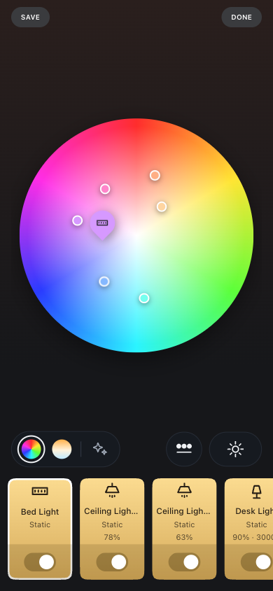
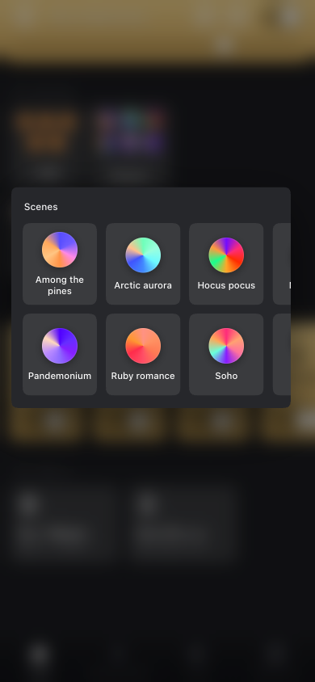
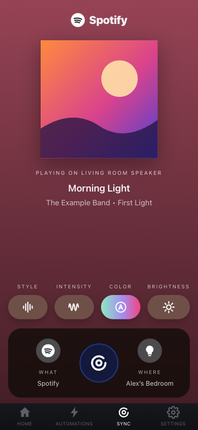
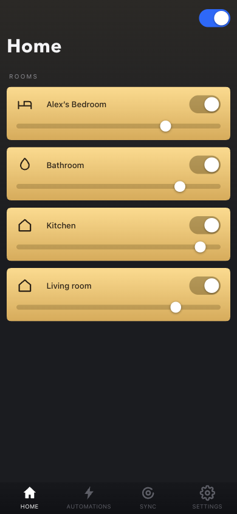
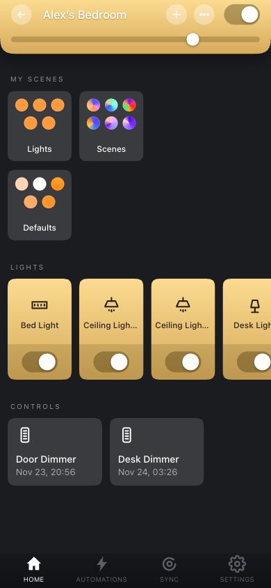
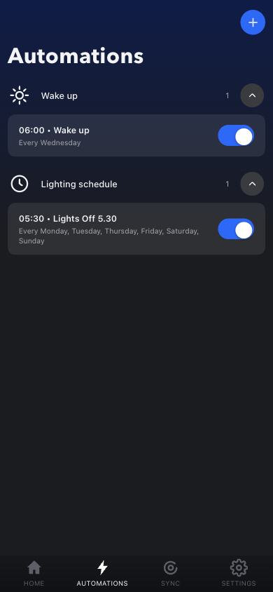
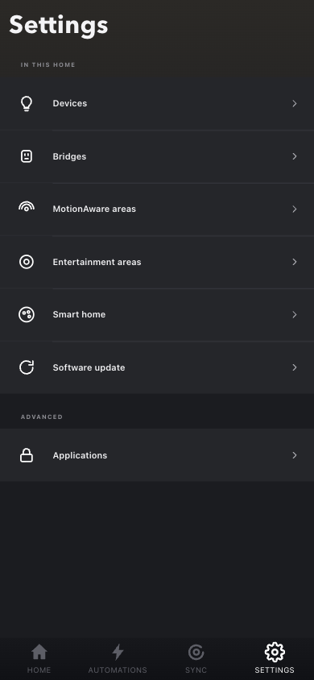

# Philips Hue Plus

Home Assistant's Hue integration covers the basics. Hue Plus adds the rest: gradient zones, effects, scene editing, the bridge's own automations and settings, Spotify sync, and a Hue panel in your sidebar that works much like the Hue app.

It's unofficial and has nothing to do with Signify.

  
  
  

  
  
  

  

## What you get

- Lights, rooms and zones with colour, white, transitions and each light's effects
- A light for every colour zone of a gradient light, with styles and colour effects
- Motion, temperature, light level and contact sensors, batteries, buttons and dials
- Bridge settings: firmware updates, authorised apps, power-on behaviour, identify, searching for new devices
- Actions to create and edit scenes, rooms, zones, entertainment areas and automations
- Spotify sync and the Hue Play HDMI Sync Box (experimental)
- The Hue panel (off until you switch it on)

You choose which of these you want, per bridge.

It can sit next to the Hue integration without touching anything, or take over from it. It also works on its own, without the Hue integration.

## Installing

You need Home Assistant 2026.10 or newer and a v2 bridge (Bridge Pro or the square v2 bridge).

1. Add `https://github.com/bora-yarkin/hue-plus` to the Marketplace as a custom repository (HACS on versions before 2026.11).
2. Download Philips Hue Plus and restart Home Assistant.
3. Go to Settings → Devices & services → Add integration → Philips Hue Plus.

Without the Marketplace, copy `custom_components/hue_plus` into your configuration folder and restart.

[Setting up](docs/manual/setup.md) walks through the choices you're asked to make.

## Documentation

- [Setting up](docs/manual/setup.md)
- [Modules and the Hue panel](docs/manual/modules.md)
- [Spotify sync and the Sync Box](docs/manual/sync.md)
- [Actions](docs/manual/actions.md)
- [Using it from your own dashboard](docs/other-dashboards.md)

For the best dashboard, pair it with [Home Control](https://github.com/bora-yarkin/home-control). Live scenes that move across a room are played by Home Control.

## Experimental parts

I don't own all the hardware Hue Plus supports. Some of it is written from Signify's documentation and the bridge's own error messages, and tested only against fakes. That covers motion sensor configuration, the HDMI Sync Box and anything Hue Secure. These are marked experimental, and listed in [docs/testing.md](docs/testing.md). If you have the hardware, reports and fixes are welcome.

## Licence

GPL-3.0-or-later, see `LICENSE`. The platforms in `custom_components/hue_plus/hue/` are copied from Home Assistant's Hue integration under Apache 2.0, see `NOTICE.md`. [Contributing](.github/CONTRIBUTING.md).
