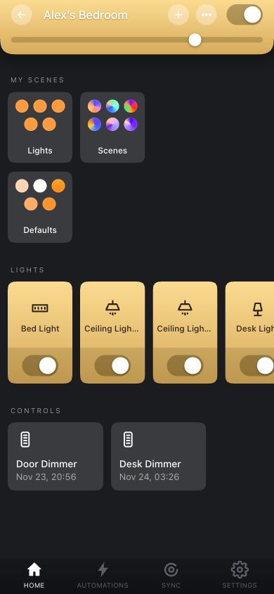
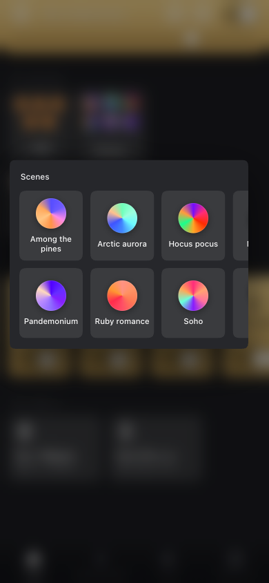

# Modules and the Hue panel

Open the integration's options and choose Choose the modules. Bridge, Lights, Devices and Zones are on to begin with.

| Module | What it does |
|---|---|
| Bridge | Firmware for the bridge and devices, authorised apps, the bridge's automations as switches, update time, Zigbee channel, per-light power-on behaviour, identify, timed effects and signals, searching for devices, and actions for scenes, rooms, zones, areas and automations |
| Lights | Hue Plus's own light, room and zone entities |
| Devices | Sensors, batteries, buttons, dials and scenes |
| Zones | One light per colour zone of a gradient light, plus styles, flip, colour effects and gradient points |
| Spotify sync | Hue's cloud Spotify sync, see [sync](sync.md) |
| Streaming | Experimental. Send colours straight to an entertainment area. Needs its own registration with the bridge |
| Dashboard | The Hue panel |

Live scenes aren't here. [Home Control](https://github.com/bora-yarkin/home-control) plays them for any light, and uses Hue Plus for Hue's native effects and for importing Hue scenes.

## The Hue panel

 

Switch on the Dashboard module and a Hue entry appears in the sidebar, for administrators.

- **Home** lists rooms and zones. Open one for its scenes and lights, and tap a light for the colour wheel.
- **Automations** shows the bridge's routines.
- **Sync** controls Spotify sync and the Sync Box.
- **Settings** has devices, bridges, motion areas, entertainment areas, smart home, updates and apps.

It reads and writes the bridge and stores nothing in Home Assistant. It doesn't need Home Control.
