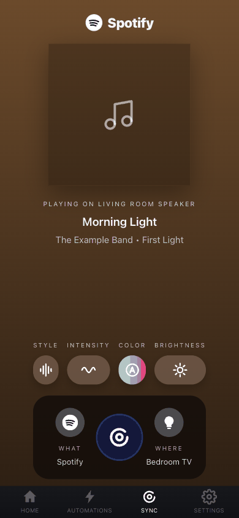

# Spotify sync and the Sync Box

## Spotify sync (experimental)

This uses a private Signify service that can change without warning. First link Spotify to your Hue account in the Hue app, then get a token or the UUID with the separate token extractor.

- **Manual token.** In the options choose Spotify Sync token and paste the `auth` and `uuid` values. When Hue stops accepting the token, get a new one and enter it again.
- **Your own developer app.** In Configure → Spotify Sync token, turn on Enter developer credentials. Register the callback URL shown on the next screen in your Remote Hue API app, then enter the App ID, Client ID, Client Secret and UUID, and sign in. The token then renews itself. If Hue revokes access, Home Assistant asks you to sign in again.

Entering a manual token again switches back.

## Hue Play HDMI Sync Box (experimental)

Add integration → Philips Hue Plus → A Hue Play HDMI Sync Box. Enter its address, hold the button on the box until the light turns green, and submit. You get a sync switch, mode, HDMI input, intensity, brightness and an HDMI signal sensor. I haven't tried this on a real box.
